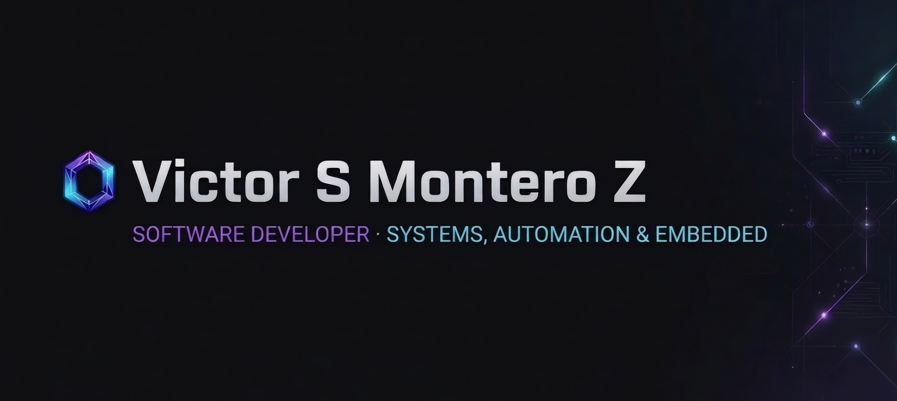

### `// SAMUEL`
`SOFTWARE DEVELOPER · SYSTEMS, AUTOMATION & EMBEDDED`

---

> [!IMPORTANT]
> Código funcional, sistemas, automatización y embebidos, respaldados por práctica real en hardware y electrónica.

### `01 // ENFOQUE TÉCNICO`

* **Software y web:** Desarrollo de aplicaciones web, servicios, herramientas e integraciones con **IA**.
* **Sistemas, automatización y embebidos:** Scripts, automatización de procesos y proyectos con sistemas embebidos.
* **Base práctica:** Experiencia de taller en diagnóstico y reparación de hardware, cómputo, servidores y electrónica.
* **Ciberseguridad:** Actualmente cursando formación y realizando prácticas en protección de sistemas y simulación de ataques (`Red Team`).

### `02 // CORE STACK`

* **Rust & Go:** Desarrollo de herramientas, servicios y sistemas.
* **Python:** `Django` · `FastAPI` · `Flask` *(desarrollo, automatización e IA)*.
* **Web:** `HTML5` y frameworks web asociados a proyectos reales.

### `03 // EXPLORACIÓN & HOBBY`

* **Proyectos hobby / bajo nivel:** `Zig` · `Nim`
* **Nivel básico / en rotación:** `JavaScript` · `TypeScript` · `PHP` · `Ruby` · `C#` · `Elixir` · `Dart` · `C` · `C++`

---

### STATS

`[STATUS: ACTIVE · BUILDING & STUDYING SECURITY]` · `// END OF FILE`
